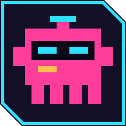
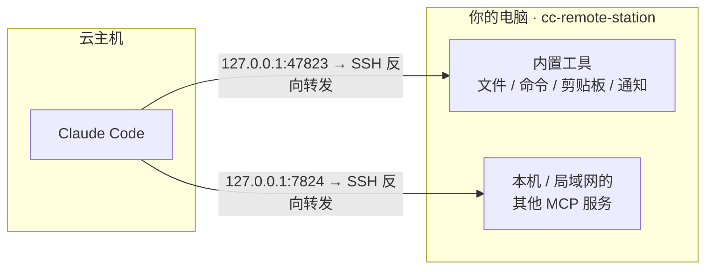

<p align="center">
  
</p>

<h1 align="center">cc-remote-station</h1>

<p align="center">
  云端 Claude Code 的桌面工作台 —— SSH 终端、图形对话、本机 MCP 工具箱，一个窗口里用好远端的 CC
</p>

<p align="center">
  <a href="https://github.com/simplifyOurLife/cc-remote-station/releases/latest"></a>
  
  <a href="LICENSE.txt"></a>
</p>

<p align="center">
  <a href="https://simplifyourlife.github.io/cc-remote-station/">官网</a> ·
  <a href="https://github.com/simplifyOurLife/cc-remote-station/releases/latest">下载</a> ·
  <a href="#快速上手">快速上手</a> ·
  <a href="#从源码构建">从源码构建</a>
</p>

---

## 为什么要它

把 Claude Code 装在云主机上跑有很多好处：网络稳、机器强、关掉笔记本任务也不断。但它也带来一串麻烦：

- 普通 SSH 客户端跟 CC 的全屏界面不太合拍，高延迟下打字发黏；
- 云端的 CC 碰不到你**本机**的文件、剪贴板和各种 MCP 服务；
- 多台主机、多个会话来回切，窗口一多就乱。

cc-remote-station 把这些放进一个桌面应用里解决。

## 特性

### 终端与对话

- **多标签、分屏**：每台主机可以同时开多个终端或对话窗格，左右 / 上下分屏
- **tmux 会话接回**：网络断了、应用重启了，云端的会话还在，点一下接回去
- **预测回显**：高延迟线路下输入立即上屏，不用等服务端回显
- **图形对话**：用聊天界面和云端 CC 对话，Markdown 渲染、工具调用卡片、权限审批、历史会话继续
- **连接稳定**：SSH 保活与死连接探测、zlib 压缩；密码和密钥口令存在系统凭据管理器

### MCP 工具箱：让云端 CC 用上本机的能力

应用在本机起一个 MCP 服务，通过 SSH **反向端口转发**提供给云主机，再一键写进云端 CC 的配置：



- **内置本机工具**：读写 / 编辑 / 搜索文件、看图片、执行命令、读写剪贴板、桌面通知、用默认程序打开文件等 17 个工具
- **接入其他 MCP**：本机 stdio 命令、本机 HTTP、局域网 HTTP 三种来源；可从本机 Claude Code / Claude Desktop / Cursor 的配置一键导入
- **按主机控制**：每台主机单独决定转发哪些工具、用什么端口；「端口转发」和「Claude 注册」分开管理，注册可选全局或指定项目
- **安全边界**：
  - 文件访问只限你勾选的目录，默认什么都不开
  - 执行命令四档管控：不允许 / 每条确认 / 白名单放行其余确认 / 全部放行，可按主机单独设置；确认弹窗里可「总是允许」加入白名单
  - 访问令牌校验，每次工具调用都有审计记录

### 其他

- **启动台**：新用户上手清单，一键检查云主机是否装了 Claude Code、是否登录、有没有 tmux
- **在线升级**：启动时自动检查，安装包带签名校验；支持走代理
- **托盘常驻**：关窗口不断开，云端的命令确认请求会弹桌面通知

## 下载安装

到 [Releases](https://github.com/simplifyOurLife/cc-remote-station/releases/latest) 下载：

| 系统 | 文件 | 说明 |
|---|---|---|
| Windows 10 / 11 | `cc-remote-station_x.y.z_x64-setup.exe` | 未做代码签名，SmartScreen 拦截时点「更多信息 → 仍要运行」 |
| macOS 11+（Intel / Apple 芯片） | `cc-remote-station_x.y.z_universal.dmg` | 未公证，首次打开请右键 → 打开；或执行 `xattr -cr /Applications/cc-remote-station.app` |

安装一次之后，新版本会在应用内提示升级。连不上 GitHub 时，在「设置 → 在线升级」里填本机代理（留空则跟随系统代理）。

## 快速上手

1. **添加主机**：「主机」页填地址、用户名，选密码 / 密钥 / ssh-agent 认证；也可以从 `~/.ssh/config` 导入
2. **检查环境**：工作区启动台里点「检查云主机环境」，没装 Claude Code 会给出安装命令
3. **打开终端或对话**：双击主机开终端；想用聊天界面就开「对话」
4. **（可选）给云端 CC 接上本机工具**：
   - 「MCP 工具箱」里勾选允许访问的本机目录、设置命令管控
   - 主机卡片上打开 MCP →「端口转发」启用工具 →「Claude 注册」一键写入云端
   - 在云端 CC 里说「读一下我桌面上的 xxx.md」试试

## 从源码构建

技术栈：[Tauri 2](https://tauri.app/) + React + TypeScript，后端 Rust（[russh](https://github.com/Eugeny/russh)、axum）。

准备：Node.js 20+、Rust stable，以及 [Tauri 的系统依赖](https://tauri.app/start/prerequisites/)（Windows 需要 MSVC 生成工具和 WebView2）。

```bash
npm install
npm run tauri dev      # 开发模式
```

打安装包需要升级签名私钥（没有的话用 `npx tauri signer generate` 生成一对，并把公钥替换进 `src-tauri/tauri.conf.json`）：

```bash
# Windows (cmd)
set TAURI_SIGNING_PRIVATE_KEY=%USERPROFILE%\.tauri\cc-remote-station.key
# macOS / Linux
export TAURI_SIGNING_PRIVATE_KEY=~/.tauri/cc-remote-station.key

npm run tauri build
```

产物在 `src-tauri/target/release/bundle/`。

### 发版

修改 `src-tauri/tauri.conf.json` 的 `version` 并提交，然后打带说明的标签：

```bash
git tag -a v0.2.0 -m "更新说明（会显示在应用的升级弹窗里）"
git push origin v0.2.0
```

GitHub Actions 会在 Windows 和 macOS 上构建，生成草稿 Release；检查无误后点 Publish，已安装的客户端就会收到升级提示。需要在仓库 Secrets 里配置 `TAURI_SIGNING_PRIVATE_KEY`。

## 许可证

[MIT](LICENSE.txt) © 2026 qiyifeng
